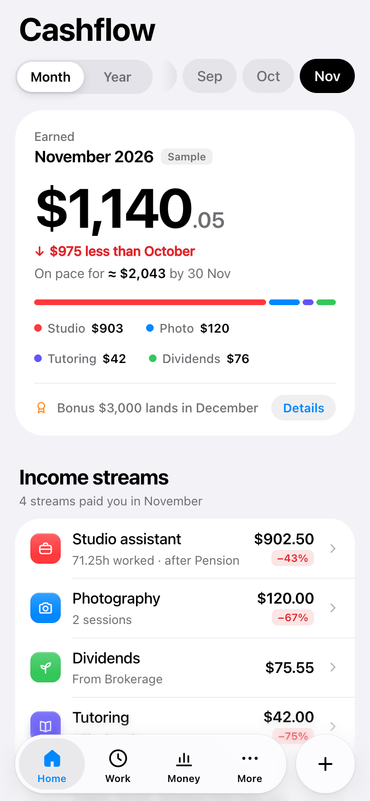
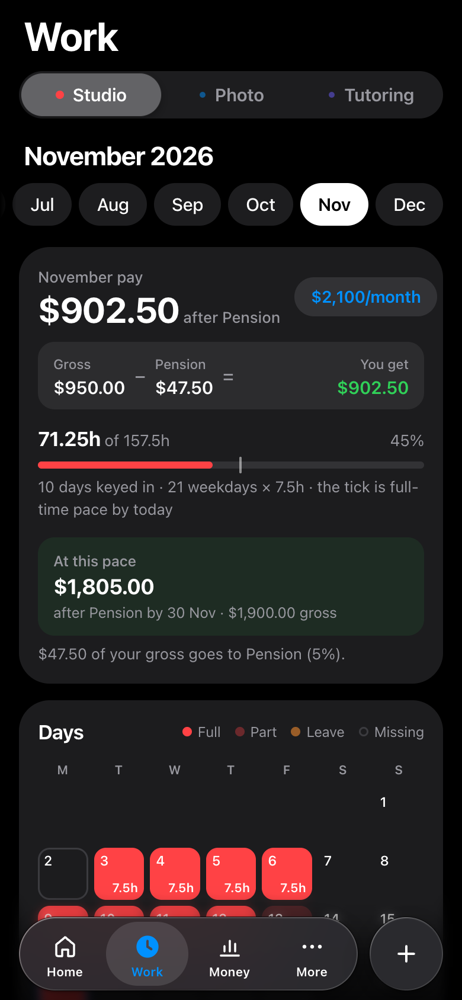
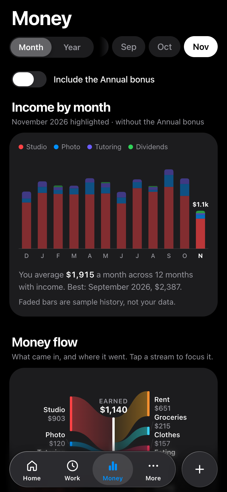
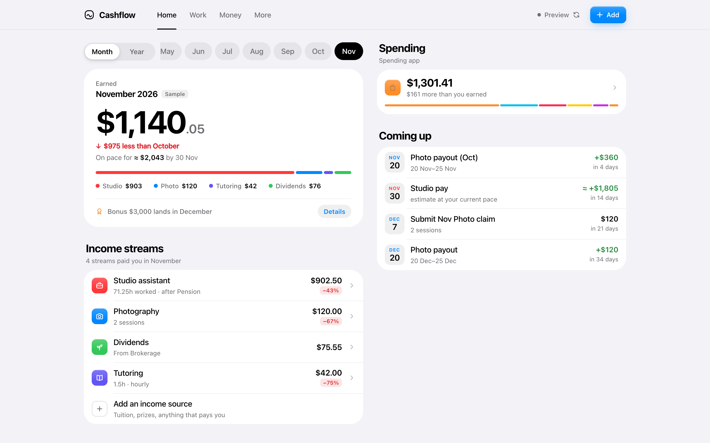
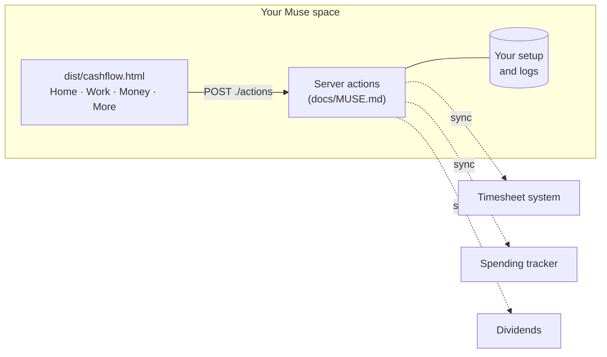

# Cashflow

A personal cashflow, timesheet and income app that runs as a [Muse](https://muse.ai) space. It shows what
you earned and where it went, month on month and year on year, and keeps your work logs, timesheets and
claims in one place, on your phone and on your laptop.

It ships as a **blank slate**: there is nothing about any one person in this repo. Muse sets it up from what
it already knows about you (your jobs, how each pays, where your spending is tracked) and stores that in
your space.

<p align="center">
  
  &nbsp;
  
  &nbsp;
  
</p>
<p align="center">
  
</p>
<p align="center"><sub>Screenshots use the built-in sample data.</sub></p>

## Features

- **Every income stream in one view.** A salaried job prorated by hours, per-session work with monthly
  claims, hourly work, a yearly lump sum such as a bonus, dividends, and anything else you add
  yourself.
- **Month on month and year on year.** Income by month, a running year-on-year comparison, and a money-flow
  diagram from each stream to each spending category. A yearly lump sum is kept out of the comparisons so
  one big month doesn't skew the rest.
- **Work logs that know your rules.** Prorated pay with whatever comes off it (a pension, social
  security, tax), a calendar of days with your leave types and work claims, claim due dates and payout
  windows, and hourly pay that's paid monthly or in one block after a term or quarter. No country's rules
  are built in: they all come from your setup.
- **Excel exports.** Your own claim form filled in cell by cell (or a clean claim workbook), monthly hours
  with leave and claims, session logs, and a yearly statement.
- **What's coming up.** Claims to submit, payouts on the way and settings still to fill in.
- **Built for Muse.** One self-contained file with no external requests and no storage. It follows Muse's
  light or dark mode, stays clear of its header, and keeps the screen edges free for the back gesture.
  It starts with a single action call, so it opens fast.
- **Feels native.** Apple's Liquid Glass design: a glass tab bar with a draggable lens on phones, a
  full-width navbar on laptops, swipes between months, pull to sync, and it works with Reduce Motion, Reduce
  Transparency, screen readers and the keyboard.

## Add it to Muse

1. Open Muse and start a chat (or open the space you want to replace).
2. Paste the prompt below and send it.
3. Answer anything Muse asks, then open the space on your phone.

```text
Build me a space called "Cashflow" from this repo: https://github.com/AxiaMil/personal-cashflow-tracker
If I already have a space that tracks my work hours, sessions or spending, put Cashflow on that space
instead, and keep its data and sync jobs.

Front end
- Use dist/cashflow.html as the space's whole front end, unchanged. It's one self-contained file made
  for Muse spaces: no external requests, no storage, phone and desktop, light and dark. Don't redesign it.

Back end
- Implement the server actions in docs/MUSE.md with exactly those names and shapes.
  tools/reference-backend.mjs is a working version of all of them to follow.
- Connect the sync jobs I need: my timesheet system for my job's days, leave and claims; where my
  spending comes from; and where my dividends come from.

Setup
- The app ships blank. Fill in the setup object (docs/MUSE.md, "Setup") from what you know about me:
  my currency and time zone; each job and how it pays (monthly pay, hours in a day, start month, what's
  taken off my pay and its rules, the leave types my timesheet system uses); per-session work and its
  claim rules (rate, session length, who the claim goes to, when it's due and paid); hourly work and when
  it pays out; any yearly payment such as a bonus; and my spending and dividend sources.
  Use my own names for things.
- Save it with saveSetup. Then show me what you filled in and ask me about anything you guessed.
- If one of my jobs has its own claim form, ask me for the blank .xlsx, return it from
  getClaimTemplate, and describe its cells in claimForm.

Check
- Follow "Checking a space" at the end of docs/MUSE.md, on my phone and on desktop.
```

If Muse can't open the repo, attach [`dist/cashflow.html`](dist/cashflow.html),
[`docs/MUSE.md`](docs/MUSE.md) and [`tools/reference-backend.mjs`](tools/reference-backend.mjs) to the
message instead.

### Changing things later

Ask Muse in the space's chat, in plain words:

- "My tutoring rate is $30 an hour from next month."
- "I started a new job: $2,400 a month, 7.5-hour days, from March."
- "Photography claims are due on the fifth working day now."
- "Stop tracking dividends."

Muse edits the setup and the app follows on its next load. The job's monthly pay and the yearly payment can
also be changed in the app, under **More**.

## How it works



- **The app** is plain JavaScript with no dependencies, built into one HTML file. It computes everything
  (pay, deductions, claims, trends, the money flow) in the browser from your setup and your logs.
- **`core/muse.js`** is the only part that talks to the space. It loads everything with one `loadAll` call,
  sends each change to Muse first and only updates the screen once Muse has saved it, and refreshes
  quietly when you come back to the space.
- **The setup** says which streams exist and how they pay. With none, the app opens on a short welcome with
  a "Set up with Muse" button and a sample-data tour.

The full contract, with every action, every shape and the setup schema, is in
[`docs/MUSE.md`](docs/MUSE.md). The code layout and design rules are in
[`docs/ARCHITECTURE.md`](docs/ARCHITECTURE.md).

## Project layout

| Path | What it is |
|---|---|
| `app/` | The app: `index.html`, `app.js` (the four screens) and `style.css` (Liquid Glass) |
| `core/` | Shared modules: data and pay rules, Muse bridge, forms, charts, Excel export, UI |
| `dist/cashflow.html` | The built, single-file app that goes into Muse |
| `docs/` | The Muse contract, architecture notes and screenshots |
| `tools/build.mjs` | Builds `dist/cashflow.html` and fails on any external reference |
| `tools/reference-backend.mjs` | Every server action, in memory: the executable spec |
| `tools/test-muse.mjs` | Runs the app core against the reference backend |
| `tools/serve.mjs`, `core/live.js` | Local dev server, with optional live sync to a timesheet API |
| `tools/mock-timesheets.mjs`, `tools/test-live.mjs` | A mock timesheet API and end-to-end tests for the dev proxy |

## Local development

Needs Node 20 or later. There's nothing to install.

```bash
node tools/serve.mjs
```

Then open http://localhost:5174/app/. Without Muse the app runs as a local preview: what you change is saved
to `data/state.local.json`, and More → Sample data fills it with made-up months.

```bash
node tools/build.mjs
```

Rebuild `dist/cashflow.html` after any change, and commit it: it's the file Muse uses.

```bash
node tools/test-muse.mjs
```

```bash
node tools/test-live.mjs --no-real
```

The first checks the Muse bridge against the reference backend; the second checks the dev server, its
timesheet proxy and the mock API.

### Your own data, locally

To preview the app with your real setup and data, keep them in local-only files. All of these are
gitignored, and the public build refuses to include them:

| File | Holds |
|---|---|
| `core/snapshot.local.js` | `CF.snapshot = {setup, months, capturedAt}`, loaded by the dev server |
| `core/templates.local.js` | Your claim form, from `node tools/embed-templates.mjs path/to/form.xlsx` |
| `*.local.json` | Anything else, such as a copy of your setup to give Muse |
| `data/state.local.json` | What you change in a local preview, saved by the dev server |
| `.env` | Optional live timesheet sync: `TIMESHEET_API_BASE` and `TIMESHEET_API_KEY` (see `.env.example`) |

`node tools/build.mjs --local` builds `dist/cashflow.local.html` with all of it baked in, for your eyes only.

## Privacy

- Nothing personal is in this repository: no names, employers, rates, accounts or figures. Muse holds those
  in your space.
- The app makes no requests of its own beyond the space's `./actions`, and stores nothing in the browser.
- Claim details (name, bank account, payment ID) stay in your space and leave it only inside a file you download.
- The dev server binds to `127.0.0.1`, only answers `localhost`, and keeps any API key server-side. The key
  is never logged or sent to the page.
